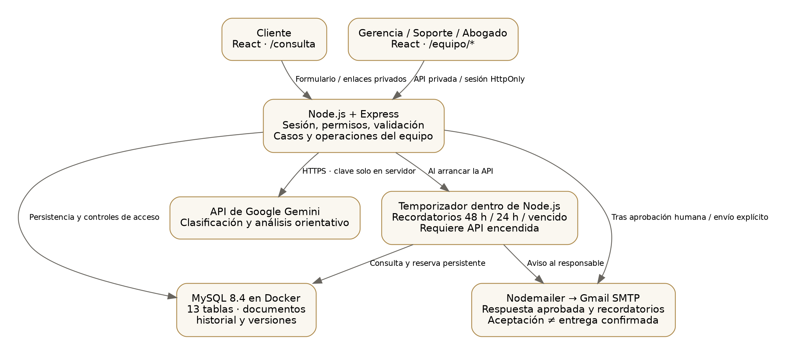
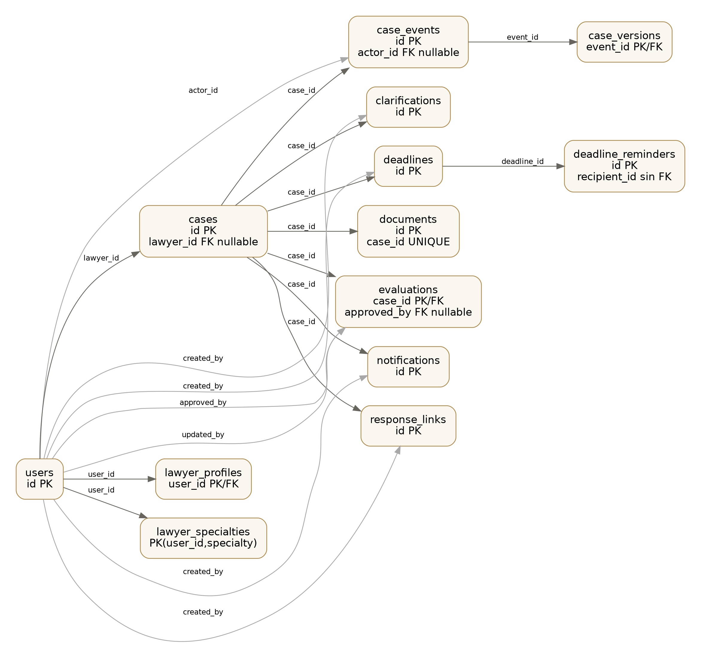
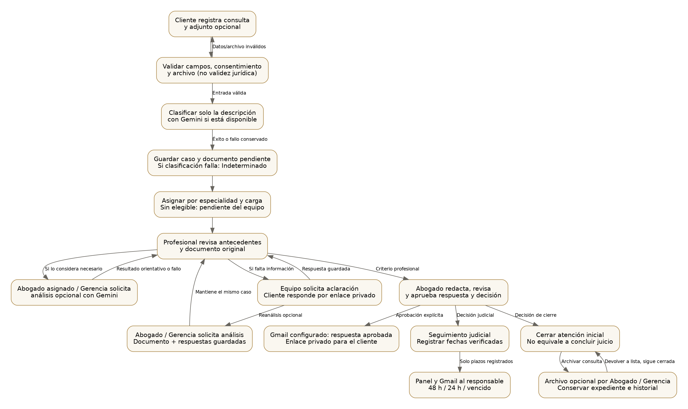

# Diagramas actuales de LegalTriage AI

Base revisada el 1 de noviembre de 2026 (`4380ba0`), con actualización del flujo documental el 3 de noviembre de 2026. Figuras técnicas de la implementación, no resultados de mediciones ni diagramas del procedimiento manual del estudio.

## Arquitectura



La interfaz React dispone de un portal público y otro del equipo. Express valida sesión, rol y acceso al caso. Gemini y Gmail se consultan desde el servidor; las claves no se entregan al navegador. El temporizador de recordatorios forma parte del proceso Node.js: no existe un servicio externo que siga enviando si se apaga la API. La fecha registrada por el profesional determina las alertas; la IA no calcula vencimientos jurídicos.

## Entidades y claves foráneas



El esquema contiene **13 tablas y 19 claves foráneas**, contrastadas mediante metadatos de MySQL y `server/src/setup.js`. Se representan claves y algunos campos relevantes; no es un diccionario completo de columnas. Las flechas van desde la tabla referenciada a la tabla que contiene la FK; las líneas grises representan FK de autoría/edición/actor. El texto `nullable` señala relaciones opcionales. Cada caso tiene como máximo un documento y una evaluación vigentes; puede acumular eventos y sus versiones.

`deadline_reminders.recipient_id` y `recipient_email` conservan el destinatario de la reserva; **recipient_id no tiene una FK física hacia users** y por eso no se dibuja esa restricción. El token de aclaraciones/respuestas se almacena como hash; los diagramas no contienen credenciales, filas de clientes ni datos de expedientes.

## Flujo de atención implementado



La validación del formulario no determina viabilidad jurídica. La clasificación inicial utiliza solo la descripción. El documento queda pendiente; el abogado asignado o Gerencia revisa el original y decide si solicita un análisis con Gemini. Soporte puede consultar los resultados guardados, pero no iniciar análisis. La solicitud de aclaración, la aprobación y la decisión de seguimiento/cierre permanecen a cargo del equipo autorizado. El reanálisis utiliza el archivo original y las respuestas guardadas del mismo caso. La aprobación puede enviar la respuesta por Gmail cuando está configurado. Los recordatorios de plazos se envían al responsable, no al cliente. La atención inicial cerrada no representa el cierre de todo un proceso judicial.

El diagrama resume el flujo; las restricciones de aprobación, plazos y permisos se detallan en la [descripción funcional](DESCRIPCION_FUNCIONAL.md) y en la [referencia técnica](../REFERENCIA_TECNICA.md).

Tras cerrar la atención, Gerencia o el abogado asignado puede archivarla opcionalmente para despejar Consultas. Archivadas conserva el expediente y permite devolverlo a la lista con el mismo estado cerrado; esto no reabre la atención ni desbloquea la evaluación aprobada.

## Fuentes editables y reproducción

- [Arquitectura DOT](diagramas/arquitectura.dot) y [SVG](diagramas/arquitectura.svg).
- [Entidades DOT](diagramas/entidades.dot) y [SVG](diagramas/entidades.svg).
- [Flujo DOT](diagramas/flujo.dot) y [SVG](diagramas/flujo.svg).
- [Metadatos de relaciones](diagramas/esquema-relaciones.json): solo nombres de tablas y claves; no contiene filas.

Para generar las figuras, con Python 3 y Graphviz instalados:

```sh
python documentacion/tesis/herramientas/generar_diagramas.py
```

El script no se conecta a MySQL. Si cambia el esquema, actualizar primero los metadatos y la descripción de campos después de contrastarlos con el código. No ejecutar las figuras antiguas del documento como si fueran una observación del proceso real; deben revisarse sus etiquetas y fuentes antes de la entrega académica.
